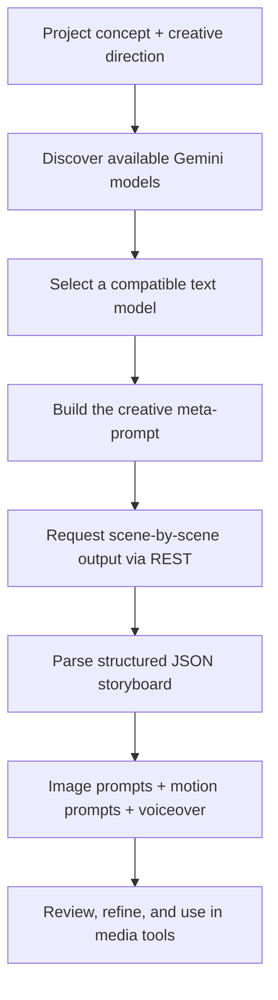

<div align="center">

# 🎬 AI Video Prompt Automator

### One idea. Every shot planned.

**A Python-powered AI art director for cinematic prompt pre-production.**

Turn a creative concept into an organized, scene-by-scene **JSON storyboard** containing visual prompts, motion directions, and voiceover scripts — ready for review and use with external generative-media tools.

[](#tech-stack)
[](#why-direct-rest)
[](#storyboard-output)
[](#how-it-works)

**[Overview](#overview) · [Workflow](#how-it-works) · [Eco-Sense case study](#case-study-eco-sense-ai) · [Quick start](#quick-start)**

</div>

---

## Overview

Creating an AI-generated promotional video often means building three connected creative assets for **every scene**:

1. A detailed prompt describing the still image.
2. A motion prompt describing how that image should move.
3. A voiceover line that fits the visual story.

Writing and coordinating those pieces manually takes time — especially when a video needs a consistent visual style from the first shot to the last.

**AI Video Prompt Automator** streamlines this stage. It takes a project concept, asks a language model to plan the visual narrative, and organizes the results into a structured JSON workflow.

> **Think of it as an AI art director's planning assistant — not an image or video renderer.**

## What it generates

| Output | Purpose | Example of what it describes |
| --- | --- | --- |
| 🎨 **Image prompt** | Establish the visual content of each shot | Scene, subject, lighting, composition, camera perspective, mood |
| 🎥 **Motion prompt** | Plan the shot's movement | Camera push-in, pan, subject motion, transitions |
| 🎙️ **Voiceover script** | Connect visuals to the message | A concise narration line for the scene |
| 🧩 **Structured storyboard** | Keep everything together | Scene-by-scene JSON that can be reviewed and reused |

The result is intended to **reduce repetitive prompt writing and improve consistency** across a creative production workflow.

## How it works



The automated stage ends at the **prompt-and-storyboard output**. Image generation, video rendering, voice synthesis, and editing take place in other tools.

## Why direct REST?

During development, changes in SDK compatibility and model availability created friction in the pre-production workflow.

Instead of coupling the script to one Python SDK version, I built a **direct HTTP integration** using the `requests` library.

This approach gives the application more explicit control over:

- **Model discovery:** request a list of models available to the API key.
- **Compatibility checks:** prefer models that support the required text-generation method.
- **Fallback choices:** select another suitable model if the preferred one is unavailable.
- **Request payloads:** construct and inspect the HTTP request and structured-output instructions.
- **Error handling:** surface API, authentication, or model-selection failures.

For example, `gemini-3.8-flash` is one supported Gemini model, but actual availability depends on the API account and the service at runtime.

**Official references:** [Gemini model listing API](https://ai.google.dev/api/models) · [Gemini 3.8 Flash](https://ai.google.dev/gemini-api/docs/models/gemini-3.8-flash)

## Case study: Eco-Sense AI

### Promoting a sustainability platform through cinematic storytelling

I used this automator while preparing promotional video material for **Eco-Sense AI**, a platform for environmental issue reporting and community engagement.

Instead of writing separate prompts for every shot, the script helped turn the project concept into a coordinated visual narrative for tools such as:

- **Leonardo.ai:** creating imagery from the generated image prompts.
- **Luma Dream Machine:** animating visual scenes from the motion directions.
- **Voiceover / editing tools:** producing narration and assembling the final sequence.

### Example creative direction

*Illustrative scene — not a literal extract from the saved output.*

| Element | Example |
| --- | --- |
| **Scene goal** | Introduce everyday environmental challenges |
| **Image direction** | A cinematic city street transitioning from scattered waste to a cleaner, greener public space; natural light and realistic detail |
| **Motion direction** | Slow aerial movement followed by a smooth forward camera push |
| **Voiceover** | “Small actions can create a cleaner future for everyone.” |

The goal is **visual continuity**: the image, movement, and narration all serve the same message.

## Storyboard output

The generated workflow is saved as:

```text
eco_sense_workflow.json
```

### Example JSON structure

The following is **illustrative**; the exact keys may vary depending on the version of `main.py`.

```json
{
  "project": "Eco-Sense AI",
  "scenes": [
    {
      "scene": 1,
      "image_prompt": "Cinematic establishing shot of a modern city...",
      "motion_prompt": "Slow forward camera movement with gentle parallax...",
      "voiceover_script": "A greener future begins with the actions we take today."
    }
  ]
}
```

The JSON keeps the creative assets grouped by scene so they are easier to review, edit, and transfer into production tools.

## Tech stack

| Component | Technology |
| --- | --- |
| **Core language** | Python |
| **HTTP integration** | `requests` |
| **LLM provider** | Google Gemini API |
| **Model selection** | API-based model discovery with fallback handling |
| **Prompt generation** | Meta-prompting for scene-oriented instructions |
| **Output** | Structured JSON |
| **Optional configuration** | Environment variables / `.env` |

## Quick start

### Prerequisites

- Python and pip
- A valid Gemini API key
- Internet access to the Gemini API

### 1 · Get the project

Download or clone the repository, then open a terminal **inside the folder containing `main.py` and `requirements.txt`**.

### 2 · Create a virtual environment

**Windows PowerShell**

```powershell
python -m venv .venv
.\.venv\Scripts\Activate.ps1
pip install -r requirements.txt
```

**macOS / Linux**

```bash
python3 -m venv .venv
source .venv/bin/activate
pip install -r requirements.txt
```

### 3 · Configure the API key

Use an environment variable or a local `.env` file **if your script is configured to read one**.

Example:

```dotenv
GEMINI_API_KEY=your_api_key_here
```

The variable name must match what `main.py` expects. Avoid putting credentials directly in source code.

> [!CAUTION]
> Never upload a real Gemini API key or your `.env` file to GitHub. Restrict and rotate credentials as appropriate.

### 4 · Run the automator

```bash
python main.py
```

After a successful run, inspect the generated `eco_sense_workflow.json`, review every prompt, and use the approved creative directions in your preferred image, motion, and audio tools.

## Scope & limitations

- **Pre-production tool:** it generates text-based creative instructions, not finished image, audio, or video files.
- **Human review matters:** AI-written directions may need refinement for accuracy, consistency, and brand voice.
- **Structured output is not infallible:** validate JSON before using it in downstream automation.
- **Model access changes:** available models, quotas, and pricing can vary by account and over time.
- **External tools are separate:** Leonardo.ai, Luma Dream Machine, and other media services are not bundled with this script.

## Ideas for future development

- [ ] Configurable project templates and visual styles
- [ ] JSON Schema validation and automated repair of malformed responses
- [ ] Command-line inputs for project title, audience, and scene count
- [ ] Batch generation for multiple campaign concepts
- [ ] Export formats for different image/video platforms
- [ ] A lightweight interface for previewing and editing storyboards

---

<div align="center">

### 🎬 From concept to cinematic direction.

**Create the story. Plan the visuals. Keep the workflow moving.**

*Python · Gemini REST API · Prompt Engineering · Creative Automation*

Created by **Toqa Alzoubi**

</div>

